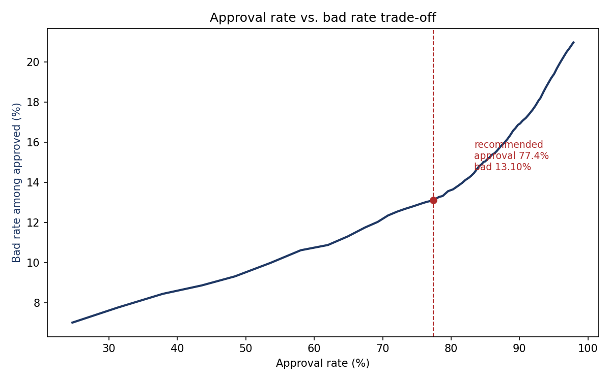

# 信贷审批策略分析报告

**数据**：UCI Default of Credit Card Clients（台湾某银行，2005），30,000 位信用卡客户
**任务**：用过去 6 期的还款行为预测下一期是否违约，并给出审批阈值建议
**模型**：WOE/IV 分箱 + Logistic 评分卡（对照 GBM）
**日期**：2026-11

---

## 一、结论（先读这一节）

> **把审批阈值设在预测违约概率 0.28 处，可以在保留 77.4% 业务量的前提下，
> 把坏账率从 22.01% 压到 13.10%——每 100 个申请少产生约 9 个坏账。**

三条支撑结论：

1. **行为特征有强区分力。** 6 期还款历史构造出的 `late_cur`（最近一期状态）IV 达 0.87，
   按逾期次数分组的违约率从 11.69% 单调升到 71.61%。
2. **不该用复杂模型。** GBM 的样本外 AUC 只比 Logistic 高 0.012，但训练-测试差是后者的
   **10.7 倍**（0.0171 vs 0.0016）——多出来的表现主要来自过拟合。
3. **模型不是单变量模型。** 去掉最强的 `late_cur` 后，AUC 只掉 0.012，说明历史逾期频率、
   额度使用率、还款比例都有独立贡献。

---

## 二、业务问题

消费信贷审批的核心权衡：

> 放宽通过率能做大业务量，坏账率随之上升；收紧则相反。

本项目要回答的不是"能不能预测违约"（这个早有答案），而是：

**在给定的风险容忍度下，审批阈值应该设在哪里？**

这是一个**决策问题**，评分卡只是手段。

---

## 三、数据与标签

| 项目 | 内容 |
|---|---|
| 来源 | UCI Default of Credit Card Clients |
| 规模 | 30,000 条 × 25 列 |
| 坏账率 | 22.12%（6,636 / 30,000） |
| 训练集 | 21,000（按 `id % 10 < 7` 切分） |
| 测试集 | 9,000 |
| 标签 | `default payment next month`：下个月是否违约 |

### 每个客户是一份 6 期的行为快照

| 字段组 | 含义 |
|---|---|
| `PAY_0`, `PAY_2..PAY_6` | 最近 6 期还款状态：`-2` 无消费 / `-1` 全额还款 / `0` 循环信用 / `1..9` 逾期月数 |
| `BILL_AMT1..6` | 各期账单金额 |
| `PAY_AMT1..6` | 各期实际还款金额 |
| `LIMIT_BAL` | 信用额度 |

**模型输入全部是已发生的历史行为，没有任何未来信息。**

### 切分方式及其代价

该数据**没有日期字段**，无法做时间切分。本项目用 `id % 10 < 7` 做确定性切分（70/30，可复现）。

> **这是本项目的主要局限。** 真实业务必须用放款日期做时间切分——随机切分会让模型从同期样本
> 中"看到"相同的宏观环境和审批政策，产生虚高的样本外表现。

---

## 四、方法

### 4.1 行为特征构造

从 18 个原始行为字段构造 8 个可解释指标：

| 特征 | 构造 | 捕捉什么 |
|---|---|---|
| `late_cnt` | 6 期中逾期期数 | 逾期频率 |
| `max_late` | 6 期最大逾期月数 | 最坏情况 |
| `late_cur` | 最近一期状态 | 当前紧迫程度 |
| `util_cur` | `BILL_AMT1 / LIMIT_BAL` | 当期额度压力 |
| `util_avg` | 6 期平均账单 / 额度 | 平均负债水平 |
| `util_trend` | `(BILL_AMT1 − BILL_AMT6) / LIMIT_BAL` | 负债在恶化还是改善 |
| `repay_ratio_cur` | `PAY_AMT1 / BILL_AMT1` | 当期还款意愿 |
| `repay_ratio_avg` | 6 期总还款 / 6 期总账单 | 长期还款能力 |

### 4.2 特征评估

- 等频分箱（最多 8 箱，`qcut` 自动合并重复边界）
- WOE 编码，IV 筛选（IV > 0.02 保留）
- **分箱与 WOE 只在训练集上拟合**，再应用到测试集

### 4.3 模型

| 模型 | 用途 |
|---|---|
| Logistic 回归（WOE 特征 + 标准化） | 评分卡本体 |
| HistGradientBoosting | 对照，检验非线性是否有增益 |

评分映射：`score = 600 − (20/ln2) × ln(PD/(1−PD))`，即 PDO = 20，PD = 0.5 对应 600 分。

### 4.4 阈值扫描

对 0.00–1.00 的 101 个阈值做网格扫描，用 SQL 的 `CROSS JOIN` 一次算出每个阈值下的：
通过率、坏账率、预期损失。**在测试集上计算。**

预期损失按「已批额度 × 60% 损失率」估算（消费信贷无抵押，违约后回收率有限）。

---

## 五、结果

### 5.1 行为特征与违约率：单调性成立

按逾期期数分组，违约率严格单调：

| `late_cnt` | 样本数 | 违约率 |
|---|---|---|
| 0 | 13,974 | 11.69% |
| 1 | 3,084 | 29.54% |
| 2 | 1,343 | 39.61% |
| 3 | 805 | 51.68% |
| 4 | 659 | 57.06% |
| 5 | 205 | 58.54% |
| 6 | 930 | 71.61% |

最近一期状态的信息量更大：

| `late_cur` | 含义 | 违约率 |
|---|---|---|
| −2 | 无消费 | 13.15% |
| −1 | 全额还款 | 16.85% |
| 0 | 循环信用 | 12.74% |
| 1 | 逾期 1 个月 | 34.57% |
| 2 | 逾期 2 个月 | 69.39% |

**注意 `-1`（全额还款）和 `0`（循环信用）的违约率都低于 `-2`（无消费）**——
说明"有消费且按时还"反而是低风险信号，而"完全不用卡"可能意味着授信未被激活或需求不足。

额度使用率同样单调：

| 使用率 | 违约率 |
|---|---|
| < 20% | 18.26% |
| 20–50% | 19.11% |
| 50–80% | 25.55% |
| 80–100% | 31.96% |
| > 100% | 32.12% |

### 5.2 变量区分度（IV）

| 变量 | IV | 解读 |
|---|---|---|
| `late_cur` | **0.874** | 最近一期是否逾期 |
| `max_late` | **0.760** | 历史最坏逾期程度 |
| `late_cnt` | **0.687** | 逾期频率 |
| `pay_avg` | 0.185 | 平均还款额 |
| `limit_bal` | 0.172 | 额度（代理收入水平） |
| `repay_ratio_cur` | 0.139 | 当期还款比例 |
| `util_avg` | 0.124 | 平均额度使用率 |
| `util_trend` | 0.078 | 负债趋势 |
| `education` | 0.050 | 教育程度 |

> IV > 0.5 通常要警惕信息泄漏。这里三个逾期类特征都偏高，原因不是泄漏，而是
> **"本月已逾期"对"下月是否违约"本身就是极强的先验**。但这意味着模型可能高度依赖
> 这几个变量——所以做了 5.4 的对照实验。

### 5.3 模型对比

| 模型 | AUC（训练） | AUC（测试） | KS（测试） | 训练−测试差 |
|---|---|---|---|---|
| **Logistic 评分卡** | 0.7709 | **0.7693** | **0.4078** | **0.0016** |
| GBM (HistGradientBoosting) | 0.7984 | 0.7814 | 0.4256 | 0.0171 |

**结论：选 Logistic。**

GBM 的样本外 AUC 高 0.0121（1.2 个百分点），但：

- **训练-测试差是 Logistic 的 10.7 倍**（0.0171 vs 0.0016），说明它在拟合训练集
- 失去系数级可解释性（每个变量对分数的贡献可以直接读出来）
- 上线需要额外的模型监控体系，监管接受度更低

在信贷场景里，**1.2 个百分点的 AUC 不值得用这些去换**。

### 5.4 稳健性：去掉最强特征会怎样

| 模型 | 全特征 AUC | 去掉 `late_cur` | 变化 |
|---|---|---|---|
| Logistic | 0.7693 | 0.7574 | −0.0119 |
| GBM | 0.7814 | 0.7683 | −0.0131 |

去掉最强的单变量后，AUC 只掉约 1.2 个百分点。

**解读**：如果掉 5 个点以上，说明模型其实只在用"本月是否已逾期"这一个信号，换任何
特征都没用。实际只掉 1.2 个点，说明历史逾期频率（`late_cnt`）、最坏逾期（`max_late`）、
还款比例（`repay_ratio`）等有独立的解释力——**模型是多元的，不是单变量伪装**。

### 5.5 审批阈值

完整权衡表（测试集 9,000 笔）：

| 阈值 | 通过率 | 坏账率 | 批准额度（百万 NT$） | 预期损失（万 NT$） |
|---|---|---|---|---|
| 0.05 | 1.24% | 3.57% | 37 | 80 |
| 0.10 | 24.68% | 7.02% | 570 | 2,400 |
| 0.15 | 53.61% | 9.99% | 982 | 5,887 |
| 0.20 | 69.28% | 12.03% | 1,190 | 8,586 |
| 0.25 | 74.93% | 12.86% | 1,263 | 9,741 |
| **0.28** | **77.37%** | **13.10%** | **1,295** | **10,177** |
| 0.30 | 78.77% | 13.32% | 1,316 | 10,514 |
| 0.40 | 84.09% | 14.80% | 1,391 | 12,348 |
| 0.60 | 91.24% | 17.33% | 1,461 | 15,187 |
| 1.00（全放行） | 100% | 22.01% | 1,528 | 20,179 |

权衡曲线：



### 5.6 为什么是 0.28

**先说清楚：0.28 不是"数学最优解"。**

本项目只计算了**损失侧**（坏账成本），没有计算**收益侧**（利息收入、获客成本、资金成本）。
在只有损失的数据下，"最优"永远是"一个都不批"——这显然荒谬。

所以这里用的是**约束优化**的表述：

> 决策规则：在「坏账率 ≤ 全放行基准 × 60%」的约束下，最大化通过率。

基准坏账率 22.01%，其 60% 为 13.21%。在满足这个约束的阈值中，0.28 对应最大的通过率（77.37%）。

在真实的业务决策中，0.28 应该作为一个**候选点**，最终选点取决于：
机构的资金成本、目标客群定位、监管对不良率的要求，以及**上线后的 A/B 实验**。

---

## 六、策略建议

**① 主策略：把审批阈值设在 PD = 0.28**

- 通过率：100% → 77.4%（放弃 22.6% 的申请）
- 坏账率：22.01% → 13.10%（下降 8.9 个百分点）
- 每 100 个申请少产生约 9 个坏账

**② 分层策略：对高风险客群单独设阈值**

建议在评分卡之上叠加一层规则，对以下客群加严（而不是一刀切拒绝）：

| 客群 | 依据 | 建议 |
|---|---|---|
| `late_cnt ≥ 3` | 违约率 > 51% | 直接拒绝或要求担保 |
| `late_cur ≥ 1` 且 `util_avg > 0.8` | 逾期且高负债 | 降额 50% |
| `pay_avg` 低且 `util_trend > 0` | 还款少且负债恶化 | 降额 + 提高定价 |

**③ 上线验证方式**

不要直接全量上线。先做**小流量灰度**（比如 5%），保留对照组，观察 4–8 周：

- 实验组通过率、坏账率是否落在预期区间
- 是否有"逆向选择"（被拒的高风险客户流向竞对，导致客群质量变化）
- 评分分箱的坏账率单调性是否保持

---

## 七、局限

1. **无法做时间切分。** 数据没有日期字段，用了 id 取模切分。随机切分会让模型看到同期
   的宏观环境，样本外表现可能被高估。
2. **拒绝推断缺失。** 模型只在已放款样本上训练，被拒客户的特征分布不可见。上线后若客群
   结构变化，模型可能失效。
3. **缺收益侧。** 只算了坏账损失，没算利息收入与获客成本，因此无法给出真正的"利润最优"阈值。
4. **样本较早。** 2005 年台湾市场，外推到当前大陆客群需谨慎。
5. **未建模额度决策。** 只决定"批不批"，没决定"给多少"。额度与定价的联合优化是下一步。

---

## 八、复现

```bash
python src/pipeline.py
```

输出：

| 文件 | 内容 |
|---|---|
| `data/clean.parquet` | 行为特征 + 切分 |
| `data/scored.parquet` | 测试集 + 预测违约概率 |
| `reports/iv_table.csv` | 变量 IV 排序 |
| `reports/model_compare.csv` | 模型对比（含对照实验） |
| `reports/threshold_sweep.csv` | 101 个阈值的完整扫描结果 |
| `reports/tradeoff.png` | 权衡曲线 |

依赖：duckdb、pandas、numpy、scikit-learn、matplotlib。
